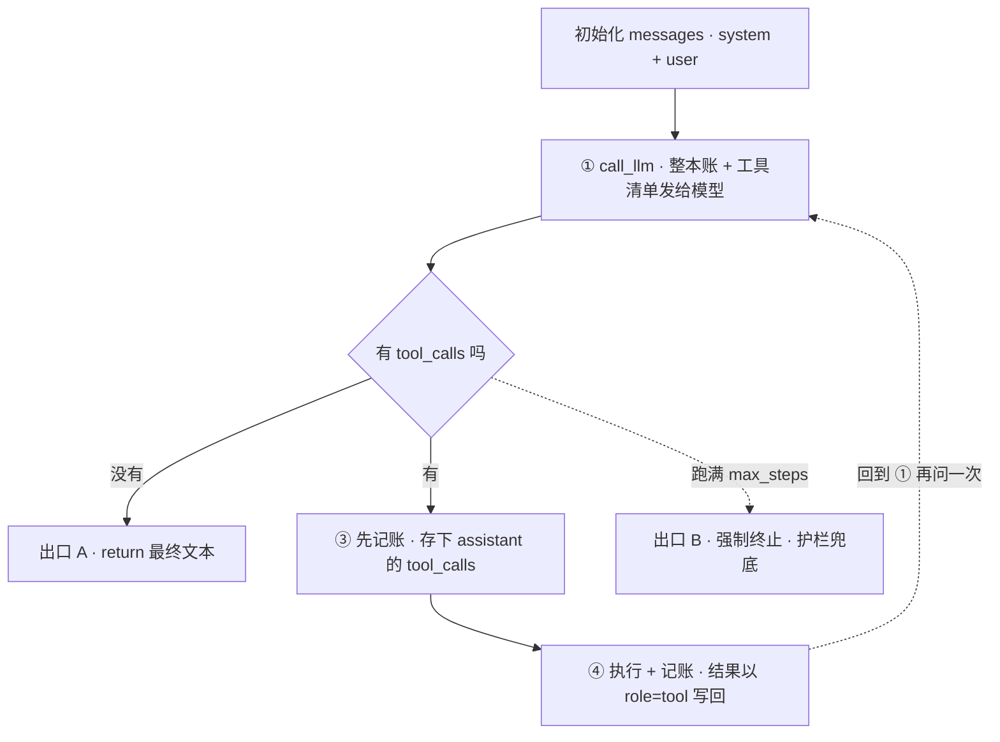

| 名词                    | 一句话答案（先自己写，再对答案）                                                |
| --------------------- | --------------------------------------------------------------- |
| Agent                 | LLM（模型） 作为大脑 + 工具 + 循环决策，能自主规划并执行多步任务                           |
| Tool/Function Calling | 应用把函数 schema 给模型，模型返回「要调哪个函数+参数」，**执行在应用侧**                     |
| ReAct                 | Reason + Act：思考→行动→观察结果→再思考 的循环范式                               |
| Planner / Executor    | 规划器拆解任务成步骤，执行器逐步调用工具完成                                          |
| Memory                | 短期（对话历史/上下文窗口）+ 长期（向量库存储，按需检索）                                  |
| RAG                   | 检索增强生成：先从知识库检索相关内容，再让 LLM 基于它回答                                 |
| Embedding             | 把文本映射成向量，语义相近则向量距离近                                             |
| MCP                   | Model Context Protocol，Anthropic 提出的工具/资源标准化连接协议，类比「AI 的 USB-C」 |
| LangGraph             | LangChain 出的状态机编排框架：节点=步骤，边=流转，支持循环和分支                          |
| Guardrail             | 护栏：输入/输出校验与拦截，防止越权、幻觉扩散、危险操作                                    |

### 1. agent

中心大脑部分，用来操作工具和决策事件
>agent是系统（模型 + 工具 + 循环 + 记忆），llm是大脑（只能思考不能动，连查天气都不会， 只能生成文字）

普通 LLM 调用是"一问一答就结束"；Agent 是"给个目标，它自己**循环**着拆步骤、调**工具**、看结果、再决定下一步（**自主决策**），直到完成"。区别就在那个**循环**。
###### 模型LLM
LLM 本身就是"模型"的全称——Large Language Model，**大语言模型**。LLM是 Agent 的一部分，Agent 是在模型外面套了一整套东西。

|           | 模型（LLM）          | Agent                  |
| --------- | ---------------- | ---------------------- |
| 本质        | 一个函数：`给文本 → 回文本` | 一个系统：模型 + 工具 + 循环 + 记忆 |
| 有记忆吗      | 没有，每次调用是独立的      | 有，能记住之前几步做了什么          |
| 能行动吗      | 不能，只会生成文字        | 能，能调工具、查数据、执行操作        |
| 会自己决定下一步吗 | 不会，你问一句它答一句      | 会，根据上一步结果自己判断要不要继续     |

- **模型** = 大脑，只会想，不会动
- **Agent** = 大脑 + 手脚 + 记忆 + 自己决定下一步干什么的循环

你计划名词表第一行写的就是：Agent = LLM 作为大脑 + 工具 + 循环决策，能自主规划并执行多步任务。

**为什么面试时要分清**

面试官常挖的坑：「你说你做了个 Agent，那它跟直接调 ChatGPT API 有什么区别？」答不上来的就是只会调 API，答得上的才懂 Agent 本质——区别就在**那个循环**。模型是"一问一答"就结束了，Agent 是"**给个目标，自己循环着拆步骤、调工具、看结果、再决定下一步，直到任务完成**"。
### 2. `Tool` / `Function Calling`
应用把函数schema给模型，**模型返回「要调哪个函数+参数」**，执行在应用侧

是`Tool`或 `Function Calling`，两个名词是一个东西，它就是LLM接收到schema吐出的一段JSON字符，这一段JSON=调用意图，代码会根据这个JSON自己决定要不要执行/怎么执行。代码获得到执行结果后，将结果喂回模型

>为什么要喂回模型：
>1. 喂回模型就是 Function Calling 流程的**最后一步**——把工具真正执行出来的结果，塞回对话历史，再发给模型一次
>2. 模型自己不知道真实世界发生了什么。它刚才只是说"去查北京天气"——它并不知道北京今天 26℃。所以**应用执行完函数、拿到真结果后，必须把这个真实结果告诉模型，它才能基于事实回答**，否则它会瞎编

总流程：
	应用把函数 schema 给模型 → 模型返回 JSON（`tool_calls`，含函数名 + 参数字符串）→ 代码解析后**自己决定**是否执行 → 把执行结果以 `role:"tool"` 喂回 messages → 模型基于真实结果继续回答、或再调工具、或直接收尾。

>完整流程是 4 步闭环：
1. 应用把**函数 schema**（工具的 JSON 描述）提交给 LLM
2. LLM 返回**要调哪个函数 + 参数**（`tool_calls`）
3. **应用侧**真实执行函数（这一步你说对了）
4. 把==执行结果以 `role:"tool"` **喂回模型** ==→ 模型才能基于真实事实继续回答（或再调工具、或直接收尾）

##### 1. 函数schema

用==JSON==描述这个函数长什么样：代码里真正有个 Python 函数 `get_weather(city)`，但**模型看不见你的代码**。你得用一份结构化的 JSON 把这个函数的签名「翻译」给模型看——这份 JSON 就是函数 schema

>低代码项目里面也有这个概念，用来描述拖拽组件的内容(?)

**类比ts**：**schema 之于函数，就像 TypeScript 类型声明之于实现**——它只描述「接口长什么样」，不含实现逻辑。OpenAI 的 function calling 用的就是 JSON Schema 标准，跟你写 TS 时碰到的 `JSONSchemaType<T>` 是同一套东西。
```ts
// 你的真实函数（模型看不到这个）
function get_weather(city: string): Weather { ... }

// schema 就是把上面这个类型签名，翻译成 JSON Schema 格式
{
  name: "get_weather",
  description: "查询指定城市当前天气",
  parameters: {
    type: "object",
    properties: { city: { type: "string", description: "城市名" } },
    required: ["city"]
  }
}
```

在今日的代码内：
![[agent名词扫盲-1792052302232.webp|450]]
- 整个TOOLS数组就是==函数 schema **列表**==，一次把多个工具一起告诉模型
- 数组里每个 `{...}`，就是**一个**函数 schema（对应一个工具）
- `"type": "function"`：API 规定的包装，声明这是"函数类型"的工具（为将来其他类型预留）
- `"function": {...}` 里：真正的接口描述：name / description / parameters
**为什么要组装成数组**：因为模型可以一次拿到**多个**工具，自己判断该用哪个。传参时是整个数组一起给
```python
json={"model": MODEL_NAME, "messages": messages, "tools": TOOLS}
                                                      # ↑ 整个列表传过去
```

**`TOOLS` 是函数 schema 的==集合==（数组），单个 `{ "type":"function", "function":{...} }` 才是一份完整的函数 schema。**

##### 2. 模型拿到schema后做什么

>应用把函数schema给模型，**模型返回「要调哪个函数+参数」**，执行在应用侧

LLM返回**要调哪个函数+参数**后：
```text
你的应用  ──tools(schema)──▶  模型
                                │ 判断：该不该调？调哪个？参数填什么？
                                ▼
你的应用  ◀──tool_calls────  返回 {"name":"get_weather","arguments":{"city":"北京"}}
   │
   ▼ 你这边执行真正的 get_weather("北京")
```
模型读完 schema 后干两件事：

1. **决定**：根据 `description` 判断当前用户问题要不要调这个函数
2. **填参**：根据 `parameters` 里的类型和描述，生成正确的 JSON 参数

### 3. ReAct

Reason + Act：==**思考→行动→观察==结果→再思考** 的==循环==范式

- **Reason**（思考）​：模型读 `messages`，判断"下一步该干嘛" → 返回 `tool_calls`
- **Act**（行动）​：应用侧**真实执行**那个函数（`DISPATCH[fn](**args)`）
- **Observation**（观察）：把执行结果以 `role:"tool"` 写回 `messages` → 模型就"看到"真实发生了什么

🪝 **记忆钩子：想 → 做 → 看**，三个字，再回到"想"。（`for` 循环是引擎，ReAct 是让它"显式想"的范式——这点在你笔记「3. ReAct」里也写了。）

---

在今天的代码内有一个for循环说是agent的本质：
![[agent名词扫盲-1792074434576.webp|475]]

>他们俩是一个意思吗

→它们**确实对应同一个循环结构**，但要分清"机制"和"范式"不是一回事：for 循环是 ReAct 跑起来的==引擎==，ReAct 是套在循环里、约束模型怎么想的==提示词范式==。引擎 ≠ 驾驶方法。

|        | for循环                 | ReAct                               |
| ------ | --------------------- | ----------------------------------- |
| 是什么    | 代码结构（自动反复问模型）         | 一种 Prompt 范式（让模型显式"想→做→看"）          |
| 管哪层    | 运行机制的**载体**           | 模型每一轮**输出格式**的约定                    |
| 你能看到什么 | 只看到模型吐出的 `tool_calls` | 能看到模型**先写 Thought（为什么）**​，再写 Action |
区别在于**思考显式不显式**？（好抽象）

ReAct是显式搬，每一轮模型会先输出一段推理文字：
```text
Thought: 用户问北京天气，我得先查 get_weather
Action: get_weather({"city":"北京"})
Observation: {"temp":"26℃"}        ← 工具结果喂回
Thought: 现在要把 26 乘2加10，用 calculate
Action: calculate({"expression":"26*2+10"})
Observation: 62
Thought: 可以回答了
```

###### 重要背景：现代 function calling 弱化了 ReAct

ReAct 是 2022 年提出的概念，**那时候还没有 function calling**。模型不能结构化返回工具调用，只能靠 prompt 让它输出 `Thought/Action/Action Input` 这种固定格式，再用正则解析。
后来 OpenAI 出了 function calling，模型直接吐 `tool_calls` 就行了——**代码的做法就是隐式 ReAct**：循环逻辑一样，只是不再需要模型用文字写 Thought。所以你现在看名词表会觉得"和 for 循环好像"——**因为底层循环范式确实就是同一套，只是表达方式升级了**。

### 4. Planner / Executor
规划器拆解任务成步骤，执行器逐步调用工具完成

- **规划器**（Planner）= 把用户的宏观目标**先拆成一份有序的步骤清单**的模块；它不亲自干活，只做"分活"。
- **执行器**（Executor）= 照着规划器拆好的步骤，**一步步调工具把活干完**的模块。

刚学完 ReAct 是"边想边做"——每走一步都由模型现场决定下一步。Planner-Executor 是**"先想清楚再动手"**：

| | ReAct（边走边看） | Planner-Executor（先规划后执行） |
|---|---|---|
| 决策时机 | 每步现场决定 | 开局先整体规划好 |
| 好处 | 灵活，能应对未知 | 可控、不乱走弯路、适合长任务 |
| 代价 | 任务长容易跑偏/超步数 | 规划错了要回退重规划 |

一句话对比你刚才的直觉： `for` 循环是 ReAct 式（模型边循环边决定）；而 `Planner-Executor` 是**在进 for 循环之前，先让模型把"我要干 Step1/2/3"列出来**，再交给执行器逐条跑。

> **规划器负责"把目标拆成步骤清单"，执行器负责"照单逐步调工具完成"——和 ReAct 的区别是它先整体规划、再执行，而不是走一步看一步。**

![[agent名词扫盲-1792075923056.webp|475]]

### 5. Memory

>短期（对话历史/上下文窗口）+ 长期（向量库存储，按需检索）

**Memory**（记忆）​ = 让 Agent 能"记得"之前发生的事、不被每次调用清零的机制。它分两种：

- **短期记忆**（你其实早就见过了）就是 for 循环里那个 `messages` 列表——它装着这轮对话的全部内容（用户的话、模型的回复、**工具调用和结果**）。
	- **特点**：活在 for 循环内，对话一结束就跟着清空
	- **致命限制**：受**上下文窗口**约束——对话太长、工具结果太多，会被"挤出去"，Agent 就忘了前面说过什么

- **长期记忆**（Day2 要动手做的）：用**向量库**（如 FAISS）把信息持久化存下来，跨会话都不丢。需要时通过 Embedding 把"相关的片段"检索出来，塞回 `messages` 一起发给模型。
	- **存什么**：用户的偏好（"Joyce 喜欢猫"）、之前确认过的事实、历史决策
	- **怎么取**：不是全量塞回去（会爆窗口），而是**按需检索**相关片段

![[agent名词扫盲-1792076105941.webp]]
- 左边 `messages` = 你下午代码里的短期记忆（已懂）
- 右边向量库 = Day2 给 Agent 接上的长期记忆
- 中间那根"检索"箭头 = **长期记忆的精髓**：不一直带着，用时才取

### 6. RAG
**RAG** = Retrieval-Augmented Generation（检索增强生成）：先**从知识库==检索**相关内容==，再**让 LLM 基于它回答**
#### 为什么需要 RAG（面试必答）

模型的知识是训练时固定的，不知道你**私有/最新**的信息（公司文档、今天的股价、你的贴纸设计规范）。RAG 让模型"开卷考试"——检索到的事实当证据塞进 prompt，它基于证据回答，**减少瞎编**。

#### RAG和Memory的区别

两者底层技术几乎一样（都是 Embedding + 向量检索），区别在**检索的内容**：

|      | Memory长期记忆 | RAG         |
| ---- | ---------- | ----------- |
| 存什么  | 对话历史、用户偏好  | 外部知识库/文档    |
| 解决什么 | "你还记得我吗"   | "你懂这个专业知识吗" |
Memory 长期记忆（向量库）和 RAG 知识库，**底层技术一模一样**（都是 chunk → Embedding → 向量库 → 检索）。
区别只有存的**内容**：Memory 存==对话==/==偏好==，RAG 存==笔记==/==文档==。
### 7. Embedding
把==文本映射成向量==，语义相近则向量距离近
#### 向量vs数学概念的向量
**向量在 AI 语境下就是数学里那个向量，没有第二种意思**。 区别只在两个地方——"向量"在这里就是"==一组数字=="

数学里向量是「有大小有方向的量」，你说的没错。在 Embedding 里，它**退化成一个浮点数数组**，比如：
```text
"猫" → [0.23, -0.51, 0.88, ..., 0.12]   ← 可能 768 / 1536 维
"狗" → [0.21, -0.48, 0.85, ..., 0.15]
"汽车" → [0.91, 0.33, -0.12, ..., -0.77]
```

- **没有别的神秘含义**，它就是个高维数字列表
- 维度很高（几百~上千维），没法画成你熟悉的二维箭头
- 所谓"方向"= 语义特征的方向；所谓"大小距离"= 语义相似度

**核心性质**​（名词表里那句）：语义相近的文本，它们的向量在空间中**距离就近**。所以"猫"和"狗"的距离，远小于"猫"和"汽车"的距离——这就是检索能"按意思找"的原理。

**向量就是高维数字列表（数学向量，无别意），==距离=语义相似度==；Embedding 把它算出来，RAG 用它先检索再生成，让模型能基于私有/最新知识回答。**

#### Embedding 和 RAG 的关系

- **Embedding**​ （嵌入）= 把文本编成上面这种向量的过程/结果。它是 RAG 的"索引"工具
- **RAG** = Retrieval-Augmented Generation（检索增强生成）：先**检索**相关知识，再让 LLM 基于它**生成**回答

![[agent名词扫盲-1792084827884.webp|525]]
看图的两阶段：

- **阶段1**​（离线建库）：知识库文档 → **切小块** → 每块 Embedding → 存进向量库
- **阶段2**​（在线问答）：用户提问 → 问题也 Embedding → 在向量库里找"离它最近"的 top-k 片段 → 把片段和问题一起喂给 LLM → 生成回答

整个建库流程：
1. 一篇5000字的md/pdf/txt/网页格式的笔记整理成知识库文档
2. 切成小块chunk，比如每一段/每一节
3. 每一个chunk单独`Embedding`
4. `Embedding`后存入向量库，建库完成

接下来就是
1. 用户提问
2. 提问也`Embedding`
3. 在库里算相似度
4. 找到最近的top-k个chunk
5. 喂给LLM

### 8. MCP
Model Context Protocol，Anthropic 提出的==**工具**/数据源之间的标准化**连接协议**==，类比「AI 的 USB-C」

Function Calling是**自己的应用提供schema给LLM，并等待LLM返回调度命令，然后自己写DISPATH执行**。那么换一个应用就要重新写接入代码。

MCP就是把Agent ↔ 工具的链接**标准化**，工具提供方按 MCP 暴露能力，Agent 按 MCP 调用，**不用每个工具都重写一遍**。

>关联：Function Calling 是你和模型"私聊"的工具约定；MCP 是 Agent 和任意工具服务之间的"通用插头"。

---
1. **不是 agent 之间**，是 **Agent ↔ 工具/资源** 之间的标准化连接协议。（MCP 是 Agent 和工具"对话"的通用语言，不是 Agent 跟 Agent 聊天。）
2. **核心痛点**要讲出来：没有 MCP 时，**每个应用每接一个工具，都要单独写一遍接入代码**（N 个应用 × M 个工具 = 一堆重复劳动）；有了 MCP，工具方按统一协议暴露一次能力，所有 Agent 即插即用。

📌 **标准答**：MCP（Model Context Protocol，Anthropic 提出的）是 **Agent 与工具/数据源之间的标准化连接协议**，把"每个应用为每把工具单独写接入"变成"通用插头，一次暴露、处处可用"。
### 9. LangGraph
LangChain 出的状态机编排**框架**：节点=步骤，边=流转，支持循环和分支

#### LangChain
一个开源框架（Python + JS/TS），把构建 LLM 应用时的重复活儿**封装成标准组件库**，让你用几行代码拼装出应用，而不是每次从 `httpx` 手写

看图——左边是你下午学的 `agent_loop.py` 里一行行手写的；右边是 LangChain 对应的现成组件：

|你手写的|LangChain 组件|
|---|---|
|`httpx.post("/chat/completions")`|`ChatOpenAI`（模型组件）|
|`TOOLS` 里的 schema|`@tool` 装饰器（一行定义工具）|
|`DISPATCH` 字典|框架自动 dispatch|
|自己写的 `for` 循环|`Chain` / `Graph`（编排）|
|你后面要加的 Memory|`Memory` 组件|

**核心卖点**：把这些"调模型、拼提示词、接工具、记记忆"的脏活标准化，用管道符 `|` 像搭积木一样串起来（这个语法叫 LCEL）。

**和 LangGraph 的关系（你刚问的）**
- **LangChain** = 基础框架（组件库 + 简单的"链"）
- **LangGraph** = LangChain 家族里专门做**有状态、可循环、可分支** Agent 编排的子框架

一句话区分：**LangChain 管"有哪些积木"，LangGraph 管怎么把积木连成带循环的图**​。你下午那个 `for` 循环，简单流程用 LangChain 的 Chain 就能表达；一旦要循环/分支/回退，就上 LangGraph
#### LangGraph
就是LangChain 出的编排框架：**用状态机编排 Agent**——节点=步骤，边=流转，支持循环和分支
代码内的 `for` 循环，处理"线性多步"没问题。但 Agent 一复杂（条件分支、并行、失败回退、循环到某步重来），硬编码 for 就乱了。LangGraph 把你的循环**升级成一张图**：
```
节点1(查天气) → 节点2(计算) → 节点3(回答)
                    ↑________|   ← 支持循环/条件回退
```

> 关联： `for step in range(max_steps)` 是"线性版 Agent"；LangGraph 是"图结构版 Agent"，能画出来讲架构（D4 要跑通）。

### 10. Guardrail（护栏）

**一句话**：输入/输出/工具调用的校验与拦截，防越权、防幻觉扩散、防危险操作。

你下午学 for 循环时，计划里提的 `max_steps` 兜底防死循环——**那是最朴素的护栏**。Guardrail 是把它体系化：
![[day1-agent名词扫盲-1792229722459.webp|425]]
- 输入护栏：过滤恶意 prompt（注入攻击）
- 输出护栏：拦截违规/有害内容
- 工具护栏：危险操作（删库、转账）先拦截或要确认

> 关联：你今晚理解的"max_steps 兜底"就是 Guardrail 的雏形；D8 工程化会专门做这一层。


### 串一下

模型（LLM）只会问答 → 套上 **for 循环**变成 **Agent** → 用 **Function Calling**（**schema** 告诉模型调哪个工具）→ **ReAct**/**Planner-Executor** 决定怎么走 → **Memory** 记上下文、跨会话 → **RAG**（**Embedding** 向量化知识库）补私有知识 → 工程上用 **MCP** 接工具、**LangGraph** 编排、**Guardrail** 兜底

### 代码存档

`agent_loop.py` —— 手写最小 Agent 循环（Day1 核心产出，已跑通：连续调用 get_weather → calculate）

```python
# agent_loop.py —— 手写最小 Agent 循环（Day1 核心产出）
#
# 目标：不依赖任何框架，用纯 Python 看清 "Agent = LLM + 工具调用的循环" 的本质。
# 这个脚本是后面 LangChain / LangGraph 的对照物，也是面试讲"你理解 Agent 本质吗"的底气。
#
# 运行前准备：
#   1) pip install httpx python-dotenv
#   2) 在本目录或上级目录建 .env，写入：
#        API_KEY=你的key
#        BASE_URL=https://dashscope.aliyuncs.com/compatible-mode/v1   # 或任何 OpenAI 兼容端点
#        MODEL_NAME=qwen-plus                                        # 按你的渠道填
#   3) python agent_loop.py
#
# 验收标准：下面那句测试问题必须【连续调用两个工具】（先 get_weather 再 calculate）后正确回答。

import os
import json
import httpx
from dotenv import load_dotenv

load_dotenv()

# 兼容多种变量名写法：你现有 .env 里用的是 API_1 / BASE_URL / MODEL_NAME
API_KEY = os.getenv("API_KEY") or os.getenv("API_1") or os.getenv("api_key")
BASE_URL = os.getenv("BASE_URL") or os.getenv("base_url")
MODEL_NAME = os.getenv("MODEL_NAME") or os.getenv("model_name")

if not API_KEY:
    raise SystemExit("未读到 API_KEY，请检查 .env（API_KEY / API_1 / api_key 任一即可）")


# ---------- 1. 工具：真实执行逻辑（在应用侧，模型碰不到） ----------
def get_weather(city: str) -> dict:
    """查询指定城市当前天气（这里用假数据演示）"""
    return {"city": city, "weather": "晴", "temp": "26℃"}
# dict 字典 储存键值对

def calculate(expression: str) -> dict:
    """计算一个数学表达式的值
    ⚠️ 仅演示用：eval 有安全风险，生产环境千万别这么写（正好是面试可讲的"护栏"点）。"""
    return {"result": eval(expression)}
# eval() 把字符串当 Python 表达式执行并返回结果，如 eval("1+2") 得 3。有安全风险，不要用于执行用户输入。

# 函数登记表：模型只返回"函数名字符串"，应用靠这张表找到真正的函数
DISPATCH = {"get_weather": get_weather, "calculate": calculate}
# 用 DISPATCH[fn](**args)按名字动态找到函数并执行，从而把模型输出的 JSON工具调用落地成实际代码调用

# ---------- 2. 函数 schema：告诉模型"有哪些工具、怎么调" ----------
TOOLS = [
    {"type": "function", "function": {
        "name": "get_weather",
        "description": "查询指定城市当前天气",
        "parameters": {
            "type": "object",
            "properties": {"city": {"type": "string", "description": "城市名，如 北京"}},
            "required": ["city"],
        }}},
    {"type": "function", "function": {
        "name": "calculate",
        "description": "计算一个数学表达式的值",
        "parameters": {
            "type": "object",
            "properties": {"expression": {"type": "string", "description": "如 3.5*12+7"}},
            "required": ["expression"],
        }}},
]


# ---------- 3. 调一次模型 ----------
def call_llm(messages: list) -> dict:
    """把 messages + tools 发给模型，返回 assistant message（可能含 tool_calls）"""
    resp = httpx.post(
        f"{BASE_URL}/chat/completions",
        headers={"Authorization": f"Bearer {API_KEY}"},
        json={"model": MODEL_NAME, "messages": messages, "tools": TOOLS},
        timeout=60,
    )
    resp.raise_for_status() # httpx/requests的相应方法：检查状态码，如果是4xx客户端错误或5xx服务端错误就抛HTTPStatusError异常，2xx/3xx就什么都不做
    return resp.json()["choices"][0]["message"]


# ---------- 4. Agent 主循环（本质所在） ----------
def run_agent(user_input: str, max_steps: int = 6) -> str:
    messages = [
        {"role": "system", "content": "你是一个助手，需要数据时调用工具，不要编造。"},
        {"role": "user", "content": user_input},
    ]

    for step in range(max_steps):          # ★ 这个 for 循环就是 Agent 的本质。agent拿到llm返回的信息并查到里面有tool_calls表示需要调用根据，就把
        # range(n)生成0至n-的整数序列
        msg = call_llm(messages)

        if msg.get("tool_calls"):          # 模型决定要调工具
            # 把模型的"调用决策"以 assistant 身份放回历史
            messages.append({
                "role": "assistant",
                "content": msg.get("content") or "",
                "tool_calls": msg["tool_calls"],
            })
            for tc in msg["tool_calls"]:
                fn = tc["function"]["name"]
                args = json.loads(tc["function"]["arguments"])   # arguments 是字符串，需再解析
                print(f"[step {step}] 调用工具 {fn}({args})")

                result = DISPATCH[fn](**args)      # ← 真正执行在应用侧
                messages.append({
                    "role": "tool",
                    "tool_call_id": tc["id"],
                    "content": json.dumps(result, ensure_ascii=False),
                })
        else:
            return msg["content"]          # 模型不再要工具 → 任务完成

    return "达到最大步数，强制终止"        # ★ 兜底：防止死循环


if __name__ == "__main__":
    question = "北京今天多少度？温度乘以2再加10是多少？"
    print(f"[user] {question}")
    print(f"[agent] {run_agent(question)}")
```

**实际运行输出**（终端实测 · sk-cp 订阅 Key + `MiniMax-M3.1-Flash-Preview`，连续调用两个工具）：

```text
[user] 北京今天多少度？温度乘以2再加10是多少？
[step 0] 调用工具 get_weather({'city': '北京'})
[step 1] 调用工具 calculate({'expression': '26*2+10'})
[agent] 北京今天晴，气温 26℃

温度乘以2再加10：26 × 2 + 10 = **62**
```

##### for循环逻辑

![[day1-agent名词扫盲-1792226370965.webp]]

**一句话**：整个 `run_agent_loop` 就是一个「**问 → 做 → 记账 → 再问**」的循环，直到模型说"我不需要工具了，这是我的答案"。

###### 1. 先纠三个容易说歪的地方

我最初的表述：*"agent 拿到 llm 返回的信息并追加到 messages 数组内，不断循环加入新的，并返回新的 toolcalling"*

| 我的说法 | 精确版 | 差在哪 |
| --- | --- | --- |
| agent 拿到 llm 返回的信息 | **我的代码**调 LLM 拿到 `msg` | agent 是整个 `run_agent_loop`；LLM 只是循环里被问一次的对象（层级混了） |
| 追加 llm 返回的信息 | 每轮追加 ==2 条==：`assistant`（模型的 tool_calls）+ `tool`（执行结果） | 只追加 1 条 → 账本**不合法**，API 会报错 |
| 返回新的 toolcalling | 返回的是==最终文本==；tool_calls 只是中间产物 | 混淆了"过程"与"返回值" |

> 补充：如果说的是"循环里不断产生新的 tool_calls"→ 对（这是**过程**）；如果说"函数返回值是 tool_calls"→ 错。函数只在两处 `return`：`msg["content"]`（正常退出）、`"达到最大步数"`（兜底）。


![[day1-agent名词扫盲-1792226645642.webp|350]]
![[day1-agent名词扫盲-1792226636700.webp|350]]

###### 2. 标准逻辑：4 步循环 + 2 个出口



**循环体（每轮做 4 件事）：**
1. **问** `msg = call_llm(messages)` —— 把整本 messages + 工具清单发出去
2. **判** `msg` 里有没有 `tool_calls`
3. **有 → 先记账**：把 `assistant + tool_calls` 存进 messages（"模型刚才决定要调什么"）
4. **再干活并记账**：`DISPATCH[fn](**args)` 真执行 → 把 `{role:"tool", tool_call_id, content}` 存回 messages → 回到第 1 步

**两个出口：**
- **出口 A（正常）**：没有 `tool_calls` → `return msg["content"]`
- **出口 B（兜底）**：跑满 `max_steps` → `return "达到最大步数，强制终止"`

###### 3. 三个"为什么"（面试加分项）

1. **为什么 `assistant` 那条也必须记账？**
   不只是"让模型记得"。硬理由是 **API 的消息格式是契约**：每条 `role:"tool"` 消息，都必须有一条带==相同 `tool_call_id`== 的 `assistant` 消息与它配对。漏了 assistant，这条 tool 就成了"孤儿消息"，下一次请求 API 会**直接报错**。所以这两笔账天生==成对==。
2. **为什么要把工具结果喂回去？**
   模型只是"说"要查天气，它并不知道北京 26℃。不给它事实，它只能瞎编。
3. **为什么返回值是文本、不是 tool_calls？**
   `tool_calls` 是"这一步要干嘛"（过程），文本才是"任务完成后的答案"（结果）。对调用方，只有答案有意义。

###### 4. role 到底是谁

`role` = ==这条消息是谁说的==：

| role | 谁说的 | 作用 |
| --- | --- | --- |
| `system` | 我（开发者） | 定规矩 |
| `user` | 用户 | 提需求 |
| **`assistant`** | **模型自己** | 它的回复；带 `tool_calls` 时 = "我要调工具" |
| `tool` | 我的代码 | 工具结果，用 `tool_call_id` 对上号 |

关键：**对话 API 是无状态的**，服务器不记得上一次请求。所以每次都要把**整本账**重新发过去——模型所谓的"记忆"，全靠这本账。

###### 5. 一句话面试话术

> "Agent 本质是个**受步数约束的循环**：每轮先==问模型==下一步做什么；它要工具，我就在**应用侧**执行，把==**决策和结果==都记进 messages** 再问下一轮；它不要工具了，就把最终文本返回。messages 就是它的全部记忆，因为 API 无状态。"

### 问答

#### 1. Agent 和普通的「直接调一次 LLM 接口」相比，本质区别是什么？
**我的回答**：agent是大脑模型是工具。agent会根据调llm接口返回的数据判断接下来做什么。
**正确和错误的部分**：✅ 抓住了核心——"循环 + 自主决策"；❌ 把 Agent 与 Model 的关系说反了（模型才是大脑，Agent 是套在外面的系统）。
**你的纠正**：模型(LLM)=大脑（只会想，被调用），Agent=套在模型外的==系统==（大脑 + 工具 + 循环 + 记忆）。标准答：普通调用是一问一答、拿到文本就结束；Agent 是给了目标后，自己循环地拆步骤、调工具、看结果、再决定下一步——**区别就在"循环"**。模型是被调用的脑子，不是工具。

#### 2. Function Calling 的完整流程是什么？
**我的回答**：应用将函数 schema 提交给 llm，llm 返回要调什么函数和参数。函数是应用在执行的。
**正确和错误的部分**：✅ 命门答对了——"函数是应用在应用侧真实执行"，不是模型自己跑；❌ 缺了第④步：执行结果还要==喂回模型==。
**你的纠正**：完整是 4 步闭环——① 把工具 schema 给模型 → ② 模型返回 `tool_calls`（函数名+参数）→ ③ 应用侧真实执行 → ④ 把结果以 `role:"tool"` 喂回模型。第④步缺了，模型就看不到事实（比如北京 26℃），只能瞎编。

#### 3. ReAct 是什么？
**我的回答**：这个不记得了（糟糕）。
**正确和错误的部分**：❌ 完全没接上，ReAct 是 Agent 最常被考的范式之一。
**你的纠正**：ReAct = **Reason（思考）→ Act（行动）→ Observation（观察）** 的==循环==，钩子记忆法就是"==想 → 做 → 看=="。模型先想下一步，调用工具做，拿到结果观察，再想……这就是 for 循环背后的"显式范式"。for 循环是引擎，ReAct 是它跑的套路。

#### 4. MCP 是什么？
**我的回答**：MCP 是类似 agent 之间的 usb 接口？
**正确和错误的部分**：✅ 类比抓对了——"USB-C"这个方向对（标准化连接）；❌ 连接对象说错了（不是 agent 之间，而是 Agent ↔ 工具/资源），且没说出它解决什么痛点。
**你的纠正**：MCP = Agent 与工具/资源之间的**标准化连接协议**，被称为"AI 的 USB-C"。它解决的是：每个应用每接一个工具都要**重复写一遍接入代码的痛点**——有了标准协议，N 个 Agent × M 个工具不用写 N×M 套适配。注意是 Agent 连工具，不是 agent 连 agent。

#### 5. Agent 怎么避免死循环？
**我的回答**：设置出口条件？
**正确和错误的部分**：✅ 一句话命中了——就是"出口条件 / 最大步数兜底"。
**你的纠正**：第一层兜底就是 `max_steps`（跑满强制终止，代码里 `return "达到最大步数"`）。更优做法是：检测重复调用（同一工具同样参数反复出现）+ 换路径 / 降级回复。这整套就是 **Guardrail（护栏）** 要管的——既要让它自主循环，又不能让它无限转。

#### 6. temperature 这个参数代表什么？
**我的回答**：temperature 高表示和知识库的接近程度高吗？我看了一下代码没有 temperature 这个字段啊。
**正确和错误的部分**：❌ 概念误认——temperature 跟"知识库接近度"无关（那是 RAG / Embedding 的事）；代码里没这个字段这点观察对了。
**你的纠正**：temperature = **随机性 / 创造性**。高=发散、有创意；低=确定、稳定。抽取工具参数这种 JSON 必须低 temp（常设 0），否则参数格式会飘。你代码里没写 temperature 字段 → 走模型默认值，这其实是**工程改进点**：工具调用场景应显式设 `temperature=0`。

###### 复盘（Day1 收尾）

> 今天我理解的 agent 是，一个带 **模型 + 工具 + 循环 + 记忆** 的系统，可以自主循环地调用工具，得到结果写入记忆并决定下一步做什么。

**一句话定稿（面试版）**：Agent = 模型(大脑) + 工具(手) + 循环(引擎) + 记忆(messages)。给它一个目标，它自己循环地拆步骤、调工具、看结果、再决定下一步，直到交出答案——核心是"循环"，普通 LLM 调用只是其中一问一答的那一步。

